<!-- Generated by scripts/build.mjs from profile.config.json. Edit those, not this file. -->

<picture><source media="(max-width: 680px)" srcset="./dist/profile-mobile.4133fda57a.svg">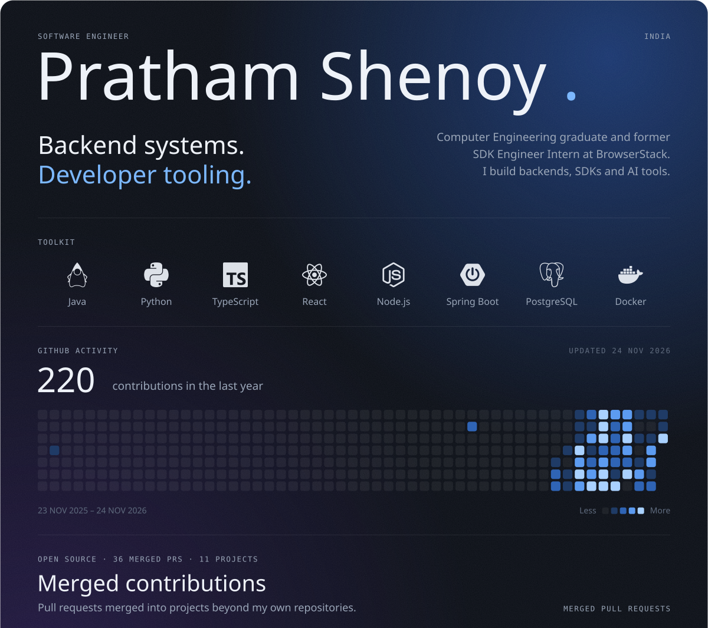</picture><picture><source media="(max-width: 680px)" srcset="./dist/panel/mustachecase-zanadir-info-mobile.e341625186.svg">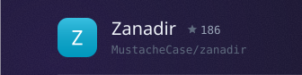</picture><a href="https://github.com/MustacheCase/zanadir/pull/684" title="fix(remote): detect settings-enabled Dependabot security updates"><picture><source media="(max-width: 680px)" srcset="./dist/panel/mustachecase-zanadir-pr0-mobile.b24a003097.svg">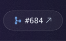</picture></a><a href="https://github.com/MustacheCase/zanadir/pull/689" title="Recognise legacy Super-linter and MegaLinter names"><picture><source media="(max-width: 680px)" srcset="./dist/panel/mustachecase-zanadir-pr1-mobile.32ee362631.svg">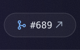</picture></a><a href="https://github.com/MustacheCase/zanadir/pull/671" title="feat(rules): recognise lockfile-lint as supply chain"><picture><source media="(max-width: 680px)" srcset="./dist/panel/mustachecase-zanadir-pr2-mobile.5e6844ae05.svg">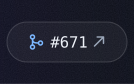</picture></a><a href="https://github.com/MustacheCase/zanadir/pull/640" title="feat(rules): recognize markdown-link-check as a linter"><picture><source media="(max-width: 680px)" srcset="./dist/panel/mustachecase-zanadir-pr3-mobile.c1cb40c8cf.svg">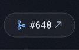</picture></a><a href="https://github.com/MustacheCase/zanadir/pull/574" title="fix(grading): report unchecked SCA ecosystems"><picture><source media="(max-width: 680px)" srcset="./dist/panel/mustachecase-zanadir-pr4-mobile.a4cf653892.svg">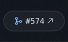</picture></a><a href="https://github.com/search?q=is%3Apr%20author%3APrathamShenoy14%20is%3Amerged%20-user%3APrathamShenoy14%20repo%3AMustacheCase%2Fzanadir&amp;type=pullrequests"><picture><source media="(max-width: 680px)" srcset="./dist/panel/mustachecase-zanadir-more-mobile.f0b48bbe92.svg"></picture></a><picture><source media="(max-width: 680px)" srcset="./dist/panel/darshi1337-apogee-info-mobile.85d3d4033d.svg"></picture><a href="https://github.com/darshi1337/apogee/pull/664" title="feat: enable remote background summaries, multi-tab synthesis and follow-up questions (B2)"><picture><source media="(max-width: 680px)" srcset="./dist/panel/darshi1337-apogee-pr0-mobile.879e4b2466.svg">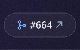</picture></a><a href="https://github.com/darshi1337/apogee/pull/617" title="feat: enable opt-in remote Summary and Ask (B1)"><picture><source media="(max-width: 680px)" srcset="./dist/panel/darshi1337-apogee-pr1-mobile.8f8b5d363b.svg">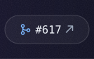</picture></a><a href="https://github.com/darshi1337/apogee/pull/606" title="feat: add shared remote client and opt-in setup (stage A)"><picture><source media="(max-width: 680px)" srcset="./dist/panel/darshi1337-apogee-pr2-mobile.69d481b007.svg">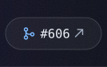</picture></a><a href="https://github.com/darshi1337/apogee/pull/595" title="fix: Preserve shared offscreen runs until the last viewer closes"><picture><source media="(max-width: 680px)" srcset="./dist/panel/darshi1337-apogee-pr3-mobile.e1fc8aafae.svg">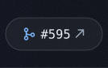</picture></a><a href="https://github.com/darshi1337/apogee/pull/571" title="perf: build history embeddings on demand"><picture><source media="(max-width: 680px)" srcset="./dist/panel/darshi1337-apogee-pr4-mobile.558d2ddd7f.svg">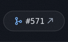</picture></a><a href="https://github.com/darshi1337/apogee/pull/480" title="fix: Reject unsupported file uploads (#472)"><picture><source media="(max-width: 680px)" srcset="./dist/panel/darshi1337-apogee-pr5-mobile.aa1b65a952.svg">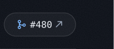</picture></a><picture><source media="(max-width: 680px)" srcset="./dist/panel/petertzy-deeplocal-chat-adapter-info-mobile.0fcc6399a3.svg"></picture><a href="https://github.com/petertzy/deeplocal-chat-adapter/pull/89" title="Add bounded read-only parallel subagents"><picture><source media="(max-width: 680px)" srcset="./dist/panel/petertzy-deeplocal-chat-adapter-pr0-mobile.06b814e640.svg">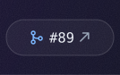</picture></a><a href="https://github.com/petertzy/deeplocal-chat-adapter/pull/87" title="Add bounded verification-driven repair cycles for coding tasks"><picture><source media="(max-width: 680px)" srcset="./dist/panel/petertzy-deeplocal-chat-adapter-pr1-mobile.cd0942f798.svg">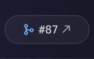</picture></a><a href="https://github.com/petertzy/deeplocal-chat-adapter/pull/84" title="Prevent TypeScript edit regressions with import and diagnostic checks"><picture><source media="(max-width: 680px)" srcset="./dist/panel/petertzy-deeplocal-chat-adapter-pr2-mobile.0ea770139c.svg">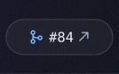</picture></a><a href="https://github.com/petertzy/deeplocal-chat-adapter/pull/76" title="Add read-only Git code review mode"><picture><source media="(max-width: 680px)" srcset="./dist/panel/petertzy-deeplocal-chat-adapter-pr3-mobile.700e715f99.svg">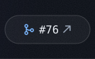</picture></a><a href="https://github.com/petertzy/deeplocal-chat-adapter/pull/63" title="test: add focused tool argument validation coverage"><picture><source media="(max-width: 680px)" srcset="./dist/panel/petertzy-deeplocal-chat-adapter-pr4-mobile.44e008d557.svg"></picture></a><a href="https://github.com/petertzy/deeplocal-chat-adapter/pull/59" title="Add copy action for completed assistant messages"><picture><source media="(max-width: 680px)" srcset="./dist/panel/petertzy-deeplocal-chat-adapter-pr5-mobile.ea455d3a44.svg"></picture></a><picture><source media="(max-width: 680px)" srcset="./dist/panel/emreocell-praxi-bot-info-mobile.a6228b3c63.svg">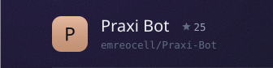</picture><a href="https://github.com/emreocell/Praxi-Bot/pull/738" title="feat(desktop): praxi:// deep links to open a bot, chat or run"><picture><source media="(max-width: 680px)" srcset="./dist/panel/emreocell-praxi-bot-pr0-mobile.2a1f559196.svg">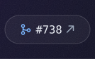</picture></a><a href="https://github.com/emreocell/Praxi-Bot/pull/485" title="feat(release): check versions and generate grouped release notes"><picture><source media="(max-width: 680px)" srcset="./dist/panel/emreocell-praxi-bot-pr1-mobile.238873d1b5.svg">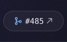</picture></a><a href="https://github.com/emreocell/Praxi-Bot/pull/423" title="fix(docs): validate Markdown heading anchors"><picture><source media="(max-width: 680px)" srcset="./dist/panel/emreocell-praxi-bot-pr2-mobile.65b16352db.svg">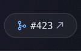</picture></a><a href="https://github.com/emreocell/Praxi-Bot/pull/327" title="feat(scripts): check contributor prerequisites"><picture><source media="(max-width: 680px)" srcset="./dist/panel/emreocell-praxi-bot-pr3-mobile.c9febe6936.svg">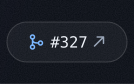</picture></a><a href="https://github.com/emreocell/Praxi-Bot/pull/265" title="feat(cli): add shell completions and man pages"><picture><source media="(max-width: 680px)" srcset="./dist/panel/emreocell-praxi-bot-pr4-mobile.acbf103f2b.svg">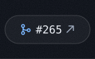</picture></a><picture><source media="(max-width: 680px)" srcset="./dist/panel/emreocell-praxi-bot-end-mobile.9a85a8dfc6.svg"></picture><picture><source media="(max-width: 680px)" srcset="./dist/panel/pipeshub-ai-pipeshub-ai-info-mobile.6bb9a3dcdb.svg"></picture><a href="https://github.com/pipeshub-ai/pipeshub-ai/pull/5750" title="feat(mcp): add official monday.com server to the catalog"><picture><source media="(max-width: 680px)" srcset="./dist/panel/pipeshub-ai-pipeshub-ai-pr0-mobile.c0410c00d8.svg">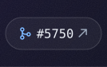</picture></a><a href="https://github.com/pipeshub-ai/pipeshub-ai/pull/5434" title="feat(mcp): add Airtable to server catalog"><picture><source media="(max-width: 680px)" srcset="./dist/panel/pipeshub-ai-pipeshub-ai-pr1-mobile.3396713c1b.svg">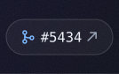</picture></a><picture><source media="(max-width: 680px)" srcset="./dist/panel/pipeshub-ai-pipeshub-ai-end-mobile.65553f1d0b.svg"></picture><picture><source media="(max-width: 680px)" srcset="./dist/panel/jamshids-aiset-info-mobile.cf68bacf26.svg"></picture><a href="https://github.com/JamshidS/aiset/pull/136" title="fix(run): reveal hidden characters in issue text"><picture><source media="(max-width: 680px)" srcset="./dist/panel/jamshids-aiset-pr0-mobile.92ab62437c.svg">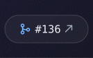</picture></a><a href="https://github.com/JamshidS/aiset/pull/133" title="fix: parse supported GitHub issue references"><picture><source media="(max-width: 680px)" srcset="./dist/panel/jamshids-aiset-pr1-mobile.ee17c32f76.svg">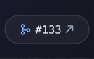</picture></a><picture><source media="(max-width: 680px)" srcset="./dist/panel/jamshids-aiset-end-mobile.949fa1b533.svg"></picture><picture><source media="(max-width: 680px)" srcset="./dist/panel/splashxmoon-friday-info-mobile.bc85218346.svg"></picture><a href="https://github.com/splashxmoon/friday/pull/10" title="Add Qwen Code support over ACP"><picture><source media="(max-width: 680px)" srcset="./dist/panel/splashxmoon-friday-pr0-mobile.7940bf5432.svg">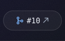</picture></a><picture><source media="(max-width: 680px)" srcset="./dist/panel/splashxmoon-friday-end-mobile.48ced5785c.svg"></picture><picture><source media="(max-width: 680px)" srcset="./dist/panel/alex-w-developer-getblocked-info-mobile.ee39a195e2.svg"></picture><a href="https://github.com/alex-w-developer/GetBlocked/pull/55" title="docs: add Decoy Mode request transformation examples"><picture><source media="(max-width: 680px)" srcset="./dist/panel/alex-w-developer-getblocked-pr0-mobile.3e098b5ec9.svg">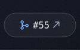</picture></a><picture><source media="(max-width: 680px)" srcset="./dist/panel/alex-w-developer-getblocked-end-mobile.a551678f5e.svg"></picture><picture><source media="(max-width: 680px)" srcset="./dist/panel/ishannaik-seatsniper-info-mobile.49a76368b7.svg"></picture><a href="https://github.com/Ishannaik/seatsniper/pull/155" title="docs: clarify Bun trust handling for Docker"><picture><source media="(max-width: 680px)" srcset="./dist/panel/ishannaik-seatsniper-pr0-mobile.19b6f559d4.svg">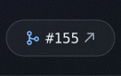</picture></a><picture><source media="(max-width: 680px)" srcset="./dist/panel/ishannaik-seatsniper-end-mobile.df0a7941b1.svg"></picture><picture><source media="(max-width: 680px)" srcset="./dist/panel/aubaidfarrukh-smart-retry-info-mobile.9d69afab00.svg">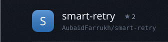</picture><a href="https://github.com/AubaidFarrukh/smart-retry/pull/70" title="feat: respect Retry-After header for fetch retries"><picture><source media="(max-width: 680px)" srcset="./dist/panel/aubaidfarrukh-smart-retry-pr0-mobile.69d5ea0209.svg">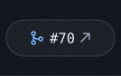</picture></a><picture><source media="(max-width: 680px)" srcset="./dist/panel/aubaidfarrukh-smart-retry-end-mobile.f714972f12.svg"></picture><picture><source media="(max-width: 680px)" srcset="./dist/panel/techkayacodes-keyboard-cheat-codes-info-mobile.a12068e393.svg"></picture><a href="https://github.com/techkayacodes/keyboard-cheat-codes/pull/34" title="feat(colorway): add Cyberpunk 2077 theme"><picture><source media="(max-width: 680px)" srcset="./dist/panel/techkayacodes-keyboard-cheat-codes-pr0-mobile.5b365584e2.svg">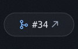</picture></a><picture><source media="(max-width: 680px)" srcset="./dist/panel/techkayacodes-keyboard-cheat-codes-end-mobile.393d91aacd.svg"></picture><a href="https://github.com/search?q=is%3Apr%20author%3APrathamShenoy14%20is%3Amerged%20-user%3APrathamShenoy14&amp;type=pullrequests"><picture><source media="(max-width: 680px)" srcset="./dist/panel/browse-all-mobile.23febcf0a8.svg"></picture></a><picture><source media="(max-width: 680px)" srcset="./dist/panel/projects-head-mobile.5a3c82b590.svg"></picture><picture><source media="(max-width: 680px)" srcset="./dist/panel/projects-edge-l-mobile.4057350ed7.svg"></picture><a href="https://github.com/PrathamShenoy14/VaultDrive"><picture><source media="(max-width: 680px)" srcset="./dist/panel/project-0-mobile.70678559be.svg">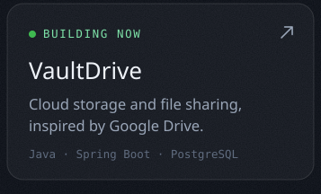</picture></a><a href="https://github.com/PrathamShenoy14/Healthbridge-AI"><picture><source media="(max-width: 680px)" srcset="./dist/panel/project-1-mobile.5f5de750d6.svg"></picture></a><a href="https://github.com/PrathamShenoy14/CareerLink"><picture><source media="(max-width: 680px)" srcset="./dist/panel/project-2-mobile.0725c7c079.svg">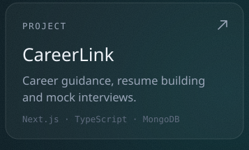</picture></a><picture><source media="(max-width: 680px)" srcset="./dist/panel/projects-edge-r-mobile.ace897a4f6.svg"></picture><picture><source media="(max-width: 680px)" srcset="./dist/panel/call-to-action-mobile.e68a1fc9b5.svg"></picture><picture><source media="(max-width: 680px)" srcset="./dist/panel/contact-edge-l-mobile.d6faa649ab.svg"></picture><a href="mailto:prathamshenoy7@gmail.com"><picture><source media="(max-width: 680px)" srcset="./dist/panel/contact-email-me-mobile.098dce8e18.svg"></picture></a><a href="https://www.linkedin.com/in/pratham-shenoy-6a4b64257/"><picture><source media="(max-width: 680px)" srcset="./dist/panel/contact-linkedin-mobile.0d5963fd9d.svg">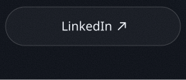</picture></a><a href="https://leetcode.com/u/prathamshenoy7/"><picture><source media="(max-width: 680px)" srcset="./dist/panel/contact-leetcode-mobile.26f41aea6d.svg">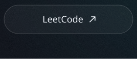</picture></a><a href="https://codeforces.com/profile/prathamshenoy7"><picture><source media="(max-width: 680px)" srcset="./dist/panel/contact-codeforces-mobile.90f9b4beaa.svg">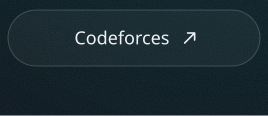</picture></a><picture><source media="(max-width: 680px)" srcset="./dist/panel/contact-edge-r-mobile.4ddb5bc337.svg"></picture>

Profile in plain text

**Pratham Shenoy** · Software Engineer · India 
Computer Engineering graduate and former SDK Engineer Intern at BrowserStack. I build backends, SDKs and AI tools.

**Toolkit:** Java · Python · TypeScript · React · Node.js · Spring Boot · PostgreSQL · Docker.

**Merged open-source contributions** (36 PRs across 11 projects):

- [Zanadir](https://github.com/MustacheCase/zanadir) - [#684](https://github.com/MustacheCase/zanadir/pull/684) fix(remote): detect settings-enabled Dependabot security updates; [#689](https://github.com/MustacheCase/zanadir/pull/689) Recognise legacy Super-linter and MegaLinter names; [#671](https://github.com/MustacheCase/zanadir/pull/671) feat(rules): recognise lockfile-lint as supply chain; [#640](https://github.com/MustacheCase/zanadir/pull/640) feat(rules): recognize markdown-link-check as a linter; [#574](https://github.com/MustacheCase/zanadir/pull/574) fix(grading): report unchecked SCA ecosystems; [#523](https://github.com/MustacheCase/zanadir/pull/523) Fix recognition and grading of quoted executable paths; [#503](https://github.com/MustacheCase/zanadir/pull/503) Recognise GuardDog as SCA; [#494](https://github.com/MustacheCase/zanadir/pull/494) feat(rules): recognise yamllint as a linter; [#482](https://github.com/MustacheCase/zanadir/pull/482) feat(grading): grade flawfinder action arguments; [#421](https://github.com/MustacheCase/zanadir/pull/421) fix: recognise markdownlint as a linter
- [Apogee](https://github.com/darshi1337/apogee) - [#664](https://github.com/darshi1337/apogee/pull/664) feat: enable remote background summaries, multi-tab synthesis and follow-up questions (B2); [#617](https://github.com/darshi1337/apogee/pull/617) feat: enable opt-in remote Summary and Ask (B1); [#606](https://github.com/darshi1337/apogee/pull/606) feat: add shared remote client and opt-in setup (stage A); [#595](https://github.com/darshi1337/apogee/pull/595) fix: Preserve shared offscreen runs until the last viewer closes; [#571](https://github.com/darshi1337/apogee/pull/571) perf: build history embeddings on demand; [#480](https://github.com/darshi1337/apogee/pull/480) fix: Reject unsupported file uploads (#472)
- [DeepLocal Chat](https://github.com/petertzy/deeplocal-chat-adapter) - [#89](https://github.com/petertzy/deeplocal-chat-adapter/pull/89) Add bounded read-only parallel subagents; [#87](https://github.com/petertzy/deeplocal-chat-adapter/pull/87) Add bounded verification-driven repair cycles for coding tasks; [#84](https://github.com/petertzy/deeplocal-chat-adapter/pull/84) Prevent TypeScript edit regressions with import and diagnostic checks; [#76](https://github.com/petertzy/deeplocal-chat-adapter/pull/76) Add read-only Git code review mode; [#63](https://github.com/petertzy/deeplocal-chat-adapter/pull/63) test: add focused tool argument validation coverage; [#59](https://github.com/petertzy/deeplocal-chat-adapter/pull/59) Add copy action for completed assistant messages
- [Praxi Bot](https://github.com/emreocell/Praxi-Bot) - [#738](https://github.com/emreocell/Praxi-Bot/pull/738) feat(desktop): praxi:// deep links to open a bot, chat or run; [#485](https://github.com/emreocell/Praxi-Bot/pull/485) feat(release): check versions and generate grouped release notes; [#423](https://github.com/emreocell/Praxi-Bot/pull/423) fix(docs): validate Markdown heading anchors; [#327](https://github.com/emreocell/Praxi-Bot/pull/327) feat(scripts): check contributor prerequisites; [#265](https://github.com/emreocell/Praxi-Bot/pull/265) feat(cli): add shell completions and man pages
- [PipesHub AI](https://github.com/pipeshub-ai/pipeshub-ai) - [#5750](https://github.com/pipeshub-ai/pipeshub-ai/pull/5750) feat(mcp): add official monday.com server to the catalog; [#5434](https://github.com/pipeshub-ai/pipeshub-ai/pull/5434) feat(mcp): add Airtable to server catalog
- [aiset](https://github.com/JamshidS/aiset) - [#136](https://github.com/JamshidS/aiset/pull/136) fix(run): reveal hidden characters in issue text; [#133](https://github.com/JamshidS/aiset/pull/133) fix: parse supported GitHub issue references
- [Friday](https://github.com/splashxmoon/friday) - [#10](https://github.com/splashxmoon/friday/pull/10) Add Qwen Code support over ACP
- [GetBlocked](https://github.com/alex-w-developer/GetBlocked) - [#55](https://github.com/alex-w-developer/GetBlocked/pull/55) docs: add Decoy Mode request transformation examples
- [SeatSniper](https://github.com/Ishannaik/seatsniper) - [#155](https://github.com/Ishannaik/seatsniper/pull/155) docs: clarify Bun trust handling for Docker
- [smart-retry](https://github.com/AubaidFarrukh/smart-retry) - [#70](https://github.com/AubaidFarrukh/smart-retry/pull/70) feat: respect Retry-After header for fetch retries
- [Keyboard Cheat Codes](https://github.com/techkayacodes/keyboard-cheat-codes) - [#34](https://github.com/techkayacodes/keyboard-cheat-codes/pull/34) feat(colorway): add Cyberpunk 2077 theme

**Featured projects:** [VaultDrive](https://github.com/PrathamShenoy14/VaultDrive) (Cloud storage and file sharing, inspired by Google Drive.) · [HealthBridge AI](https://github.com/PrathamShenoy14/Healthbridge-AI) (Dermatology assistant with image analysis, RAG and AI chat.) · [CareerLink](https://github.com/PrathamShenoy14/CareerLink) (Career guidance, resume building and mock interviews.)

**Contact:** [Email me](mailto:prathamshenoy7@gmail.com) · [LinkedIn](https://www.linkedin.com/in/pratham-shenoy-6a4b64257/) · [LeetCode](https://leetcode.com/u/prathamshenoy7/) · [Codeforces](https://codeforces.com/profile/prathamshenoy7) · [CodeChef](https://www.codechef.com/users/prathamshenoy)

**GitHub activity:** 220 contributions in the last year. Last refreshed 24 NOV 2026.

