<!-- Generated by scripts/build.mjs from profile.config.json. Edit those, not this file. -->

<picture><source media="(max-width: 680px)" srcset="./dist/profile-mobile.3c64ba084f.svg">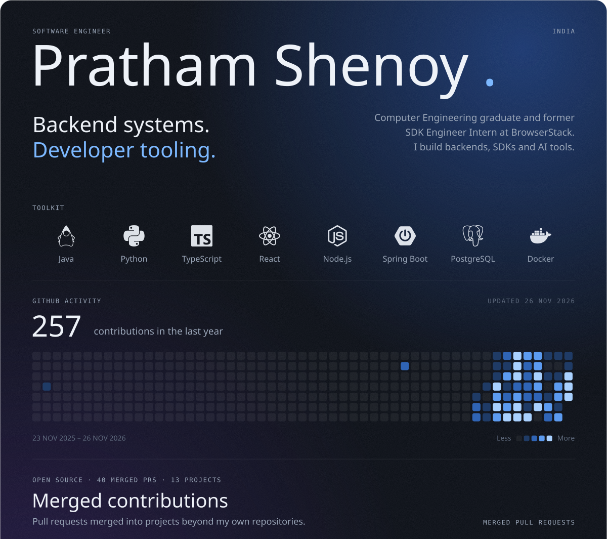</picture><a href="https://github.com/MustacheCase/zanadir" title="Open-source CI/CD security tool: finds the security checks your pipeline is missing, and the ones that can never fail the build. GitHub Actions, GitLab CI and more."><picture><source media="(max-width: 680px)" srcset="./dist/panel/mustachecase-zanadir-info-mobile.b4d3def64b.svg">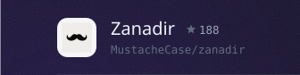</picture></a><a href="https://github.com/MustacheCase/zanadir/pull/684" title="fix(remote): detect settings-enabled Dependabot security updates"><picture><source media="(max-width: 680px)" srcset="./dist/panel/mustachecase-zanadir-pr0-mobile.a1ddbc606f.svg">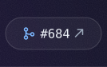</picture></a><a href="https://github.com/MustacheCase/zanadir/pull/689" title="Recognise legacy Super-linter and MegaLinter names"><picture><source media="(max-width: 680px)" srcset="./dist/panel/mustachecase-zanadir-pr1-mobile.6a6338fe9a.svg">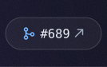</picture></a><a href="https://github.com/MustacheCase/zanadir/pull/671" title="feat(rules): recognise lockfile-lint as supply chain"><picture><source media="(max-width: 680px)" srcset="./dist/panel/mustachecase-zanadir-pr2-mobile.422d5894ce.svg">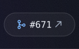</picture></a><a href="https://github.com/MustacheCase/zanadir/pull/640" title="feat(rules): recognize markdown-link-check as a linter"><picture><source media="(max-width: 680px)" srcset="./dist/panel/mustachecase-zanadir-pr3-mobile.909b7c0856.svg">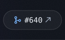</picture></a><a href="https://github.com/MustacheCase/zanadir/pull/574" title="fix(grading): report unchecked SCA ecosystems"><picture><source media="(max-width: 680px)" srcset="./dist/panel/mustachecase-zanadir-pr4-mobile.82c7ae36e6.svg">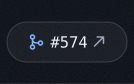</picture></a><a href="https://github.com/search?q=is%3Apr%20author%3APrathamShenoy14%20is%3Amerged%20-user%3APrathamShenoy14%20repo%3AMustacheCase%2Fzanadir&amp;type=pullrequests"><picture><source media="(max-width: 680px)" srcset="./dist/panel/mustachecase-zanadir-more-mobile.73f6d16913.svg"></picture></a><a href="https://github.com/darshi1337/apogee" title="Private AI summarizer for anything you read. Inspired by Mozilla's Orbit."><picture><source media="(max-width: 680px)" srcset="./dist/panel/darshi1337-apogee-info-mobile.701f993da1.svg"></picture></a><a href="https://github.com/darshi1337/apogee/pull/664" title="feat: enable remote background summaries, multi-tab synthesis and follow-up questions (B2)"><picture><source media="(max-width: 680px)" srcset="./dist/panel/darshi1337-apogee-pr0-mobile.d6420a28b7.svg">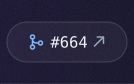</picture></a><a href="https://github.com/darshi1337/apogee/pull/617" title="feat: enable opt-in remote Summary and Ask (B1)"><picture><source media="(max-width: 680px)" srcset="./dist/panel/darshi1337-apogee-pr1-mobile.c5b183cec3.svg">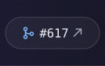</picture></a><a href="https://github.com/darshi1337/apogee/pull/606" title="feat: add shared remote client and opt-in setup (stage A)"><picture><source media="(max-width: 680px)" srcset="./dist/panel/darshi1337-apogee-pr2-mobile.168730afd1.svg">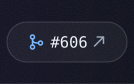</picture></a><a href="https://github.com/darshi1337/apogee/pull/595" title="fix: Preserve shared offscreen runs until the last viewer closes"><picture><source media="(max-width: 680px)" srcset="./dist/panel/darshi1337-apogee-pr3-mobile.3236790f80.svg">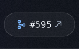</picture></a><a href="https://github.com/darshi1337/apogee/pull/571" title="perf: build history embeddings on demand"><picture><source media="(max-width: 680px)" srcset="./dist/panel/darshi1337-apogee-pr4-mobile.c0c4c05d83.svg">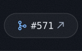</picture></a><a href="https://github.com/darshi1337/apogee/pull/480" title="fix: Reject unsupported file uploads (#472)"><picture><source media="(max-width: 680px)" srcset="./dist/panel/darshi1337-apogee-pr5-mobile.0d04aaec11.svg">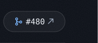</picture></a><a href="https://github.com/emreocell/Praxi-Bot" title="Local-first, open-source AI agent platform built with Rust and Tauri. Desktop automation, multi-agent workflows, permission controls, and local or cloud LLMs."><picture><source media="(max-width: 680px)" srcset="./dist/panel/emreocell-praxi-bot-info-mobile.3ea5b98ae3.svg"></picture></a><a href="https://github.com/emreocell/Praxi-Bot/pull/866" title="feat(ui): standing grants view in the Vault screen"><picture><source media="(max-width: 680px)" srcset="./dist/panel/emreocell-praxi-bot-pr0-mobile.14c537ab7a.svg">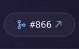</picture></a><a href="https://github.com/emreocell/Praxi-Bot/pull/738" title="feat(desktop): praxi:// deep links to open a bot, chat or run"><picture><source media="(max-width: 680px)" srcset="./dist/panel/emreocell-praxi-bot-pr1-mobile.7145aa4f06.svg">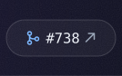</picture></a><a href="https://github.com/emreocell/Praxi-Bot/pull/485" title="feat(release): check versions and generate grouped release notes"><picture><source media="(max-width: 680px)" srcset="./dist/panel/emreocell-praxi-bot-pr2-mobile.180579cf8b.svg">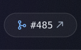</picture></a><a href="https://github.com/emreocell/Praxi-Bot/pull/423" title="fix(docs): validate Markdown heading anchors"><picture><source media="(max-width: 680px)" srcset="./dist/panel/emreocell-praxi-bot-pr3-mobile.8a1a82f720.svg">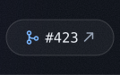</picture></a><a href="https://github.com/emreocell/Praxi-Bot/pull/327" title="feat(scripts): check contributor prerequisites"><picture><source media="(max-width: 680px)" srcset="./dist/panel/emreocell-praxi-bot-pr4-mobile.46c96bc2ee.svg">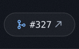</picture></a><a href="https://github.com/emreocell/Praxi-Bot/pull/265" title="feat(cli): add shell completions and man pages"><picture><source media="(max-width: 680px)" srcset="./dist/panel/emreocell-praxi-bot-pr5-mobile.66094e1328.svg">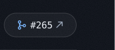</picture></a><a href="https://github.com/petertzy/deeplocal-chat-adapter" title="VS Code extension for chatting with and delegating coding tasks to local DeepLocal OpenAI-compatible models."><picture><source media="(max-width: 680px)" srcset="./dist/panel/petertzy-deeplocal-chat-adapter-info-mobile.6a6e81efb2.svg">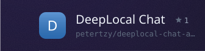</picture></a><a href="https://github.com/petertzy/deeplocal-chat-adapter/pull/89" title="Add bounded read-only parallel subagents"><picture><source media="(max-width: 680px)" srcset="./dist/panel/petertzy-deeplocal-chat-adapter-pr0-mobile.5492982277.svg">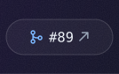</picture></a><a href="https://github.com/petertzy/deeplocal-chat-adapter/pull/87" title="Add bounded verification-driven repair cycles for coding tasks"><picture><source media="(max-width: 680px)" srcset="./dist/panel/petertzy-deeplocal-chat-adapter-pr1-mobile.3e7eb05114.svg">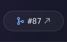</picture></a><a href="https://github.com/petertzy/deeplocal-chat-adapter/pull/84" title="Prevent TypeScript edit regressions with import and diagnostic checks"><picture><source media="(max-width: 680px)" srcset="./dist/panel/petertzy-deeplocal-chat-adapter-pr2-mobile.abdc39d888.svg">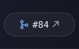</picture></a><a href="https://github.com/petertzy/deeplocal-chat-adapter/pull/76" title="Add read-only Git code review mode"><picture><source media="(max-width: 680px)" srcset="./dist/panel/petertzy-deeplocal-chat-adapter-pr3-mobile.415669d786.svg">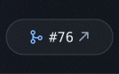</picture></a><a href="https://github.com/petertzy/deeplocal-chat-adapter/pull/63" title="test: add focused tool argument validation coverage"><picture><source media="(max-width: 680px)" srcset="./dist/panel/petertzy-deeplocal-chat-adapter-pr4-mobile.01021d071a.svg">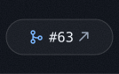</picture></a><a href="https://github.com/petertzy/deeplocal-chat-adapter/pull/59" title="Add copy action for completed assistant messages"><picture><source media="(max-width: 680px)" srcset="./dist/panel/petertzy-deeplocal-chat-adapter-pr5-mobile.6047ee9d66.svg"></picture></a><a href="https://github.com/JamshidS/aiset" title="Turn your repos into a team of Claude Code agents with persistent memory, coordinated tasks, and a live dashboard."><picture><source media="(max-width: 680px)" srcset="./dist/panel/jamshids-aiset-info-mobile.188f7b6763.svg"></picture></a><a href="https://github.com/JamshidS/aiset/pull/138" title="feat(run): summarize task costs"><picture><source media="(max-width: 680px)" srcset="./dist/panel/jamshids-aiset-pr0-mobile.6515a4d166.svg">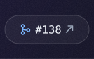</picture></a><a href="https://github.com/JamshidS/aiset/pull/136" title="fix(run): reveal hidden characters in issue text"><picture><source media="(max-width: 680px)" srcset="./dist/panel/jamshids-aiset-pr1-mobile.7241adc69f.svg">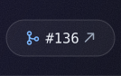</picture></a><a href="https://github.com/JamshidS/aiset/pull/133" title="fix: parse supported GitHub issue references"><picture><source media="(max-width: 680px)" srcset="./dist/panel/jamshids-aiset-pr2-mobile.315f7b448c.svg">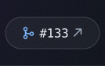</picture></a><picture><source media="(max-width: 680px)" srcset="./dist/panel/jamshids-aiset-end-mobile.bb87f665f7.svg"></picture><a href="https://github.com/pipeshub-ai/pipeshub-ai" title="The open-source context layer for AI agents and enterprise AI search. Permission-aware search and cited answers across 30+ sources, including Slack, Drive, Jira, GitHub and Microsoft 365, for people and agents through MCP, SDKs and built-in agents. Self-hosted or Cloud."><picture><source media="(max-width: 680px)" srcset="./dist/panel/pipeshub-ai-pipeshub-ai-info-mobile.fa3dfdaeed.svg">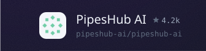</picture></a><a href="https://github.com/pipeshub-ai/pipeshub-ai/pull/5750" title="feat(mcp): add official monday.com server to the catalog"><picture><source media="(max-width: 680px)" srcset="./dist/panel/pipeshub-ai-pipeshub-ai-pr0-mobile.6266900b91.svg">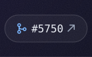</picture></a><a href="https://github.com/pipeshub-ai/pipeshub-ai/pull/5434" title="feat(mcp): add Airtable to server catalog"><picture><source media="(max-width: 680px)" srcset="./dist/panel/pipeshub-ai-pipeshub-ai-pr1-mobile.e19b556984.svg">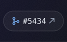</picture></a><picture><source media="(max-width: 680px)" srcset="./dist/panel/pipeshub-ai-pipeshub-ai-end-mobile.f0139f11ea.svg"></picture><a href="https://github.com/splashxmoon/friday-code" title="One app for all your coding agents: Claude Code, Codex, Cursor and 15 more, on the subscriptions you already pay for. Run them side by side, or let them split a job and review each other's work. Free, open source."><picture><source media="(max-width: 680px)" srcset="./dist/panel/splashxmoon-friday-code-info-mobile.28ec3309fc.svg">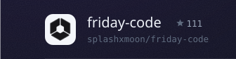</picture></a><a href="https://github.com/splashxmoon/friday-code/pull/10" title="Add Qwen Code support over ACP"><picture><source media="(max-width: 680px)" srcset="./dist/panel/splashxmoon-friday-code-pr0-mobile.fc11ec3cb6.svg">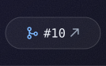</picture></a><picture><source media="(max-width: 680px)" srcset="./dist/panel/splashxmoon-friday-code-end-mobile.e7145248c9.svg"></picture><a href="https://github.com/alex-w-developer/GetBlocked" title="Lightweight, local-only MV3 Chrome extension for reducing common third-party web tracking."><picture><source media="(max-width: 680px)" srcset="./dist/panel/alex-w-developer-getblocked-info-mobile.1ad66bd102.svg"></picture></a><a href="https://github.com/alex-w-developer/GetBlocked/pull/55" title="docs: add Decoy Mode request transformation examples"><picture><source media="(max-width: 680px)" srcset="./dist/panel/alex-w-developer-getblocked-pr0-mobile.ffe2fa6755.svg">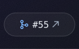</picture></a><picture><source media="(max-width: 680px)" srcset="./dist/panel/alex-w-developer-getblocked-end-mobile.dbd6b57ac2.svg"></picture><a href="https://github.com/NexyPy/nexy" title="Next.js, in Python. Same file routes, same layouts, same islands, with Python on the server. FastAPI + Vite in one process: no second server, no CORS block."><picture><source media="(max-width: 680px)" srcset="./dist/panel/nexypy-nexy-info-mobile.4eac98296d.svg"></picture></a><a href="https://github.com/NexyPy/nexy/pull/672" title="feat(router): add useRateLimit, a 429 for a client that calls too often"><picture><source media="(max-width: 680px)" srcset="./dist/panel/nexypy-nexy-pr0-mobile.6caa352364.svg">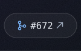</picture></a><picture><source media="(max-width: 680px)" srcset="./dist/panel/nexypy-nexy-end-mobile.dce940949a.svg"></picture><a href="https://github.com/Ishannaik/seatsniper" title="Discord bot that watches BookMyShow and DMs you the moment tickets open. Self-hosted with one command. Bun + TypeScript + SQLite, no API keys."><picture><source media="(max-width: 680px)" srcset="./dist/panel/ishannaik-seatsniper-info-mobile.a93f9e6069.svg"></picture></a><a href="https://github.com/Ishannaik/seatsniper/pull/155" title="docs: clarify Bun trust handling for Docker"><picture><source media="(max-width: 680px)" srcset="./dist/panel/ishannaik-seatsniper-pr0-mobile.c13699a24e.svg">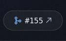</picture></a><picture><source media="(max-width: 680px)" srcset="./dist/panel/ishannaik-seatsniper-end-mobile.157659a9ef.svg"></picture><a href="https://github.com/AubaidFarrukh/smart-retry" title="Intelligent HTTP retry with exponential backoff, automatic failure logging, and replay support"><picture><source media="(max-width: 680px)" srcset="./dist/panel/aubaidfarrukh-smart-retry-info-mobile.8966e43e8b.svg">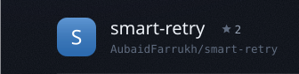</picture></a><a href="https://github.com/AubaidFarrukh/smart-retry/pull/70" title="feat: respect Retry-After header for fetch retries"><picture><source media="(max-width: 680px)" srcset="./dist/panel/aubaidfarrukh-smart-retry-pr0-mobile.15739fcd80.svg">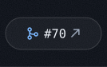</picture></a><picture><source media="(max-width: 680px)" srcset="./dist/panel/aubaidfarrukh-smart-retry-end-mobile.eda61f12b4.svg"></picture><a href="https://github.com/techkayacodes/keyboard-cheat-codes" title="An interactive digital keyboard playground: explore keyboard layouts, test shortcuts, play typing games, and hear switch-inspired sounds."><picture><source media="(max-width: 680px)" srcset="./dist/panel/techkayacodes-keyboard-cheat-codes-info-mobile.0cab868876.svg"></picture></a><a href="https://github.com/techkayacodes/keyboard-cheat-codes/pull/34" title="feat(colorway): add Cyberpunk 2077 theme"><picture><source media="(max-width: 680px)" srcset="./dist/panel/techkayacodes-keyboard-cheat-codes-pr0-mobile.08f0b6c9ae.svg">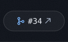</picture></a><picture><source media="(max-width: 680px)" srcset="./dist/panel/techkayacodes-keyboard-cheat-codes-end-mobile.42c921c5f1.svg"></picture><a href="https://github.com/RubahAnomali/patchlint" title="Beginner-friendly security linter for Dockerfiles and GitHub Actions workflows. Every finding explains why it matters and how to fix it."><picture><source media="(max-width: 680px)" srcset="./dist/panel/rubahanomali-patchlint-info-mobile.a8a5bfa761.svg">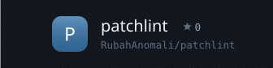</picture></a><a href="https://github.com/RubahAnomali/patchlint/pull/59" title="feat: add a GitHub Action so patchlint runs with uses:"><picture><source media="(max-width: 680px)" srcset="./dist/panel/rubahanomali-patchlint-pr0-mobile.0127971e79.svg">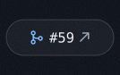</picture></a><picture><source media="(max-width: 680px)" srcset="./dist/panel/rubahanomali-patchlint-end-mobile.69ea946f98.svg"></picture><a href="https://github.com/search?q=is%3Apr%20author%3APrathamShenoy14%20is%3Amerged%20-user%3APrathamShenoy14&amp;type=pullrequests"><picture><source media="(max-width: 680px)" srcset="./dist/panel/browse-all-mobile.201bc7fc55.svg"></picture></a><picture><source media="(max-width: 680px)" srcset="./dist/panel/projects-head-mobile.5c0a19107b.svg"></picture><picture><source media="(max-width: 680px)" srcset="./dist/panel/projects-edge-l-mobile.e8ed8781e9.svg"></picture><a href="https://github.com/PrathamShenoy14/VaultDrive"><picture><source media="(max-width: 680px)" srcset="./dist/panel/project-0-mobile.f5ee67cb29.svg">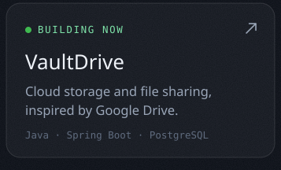</picture></a><a href="https://github.com/PrathamShenoy14/Healthbridge-AI"><picture><source media="(max-width: 680px)" srcset="./dist/panel/project-1-mobile.bc2c469968.svg">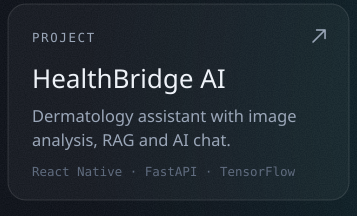</picture></a><a href="https://github.com/PrathamShenoy14/CareerLink"><picture><source media="(max-width: 680px)" srcset="./dist/panel/project-2-mobile.a69d962804.svg">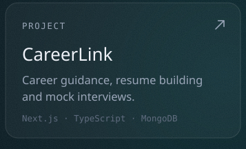</picture></a><picture><source media="(max-width: 680px)" srcset="./dist/panel/projects-edge-r-mobile.3dedbf1357.svg"></picture><picture><source media="(max-width: 680px)" srcset="./dist/panel/call-to-action-mobile.c911dc9ee4.svg">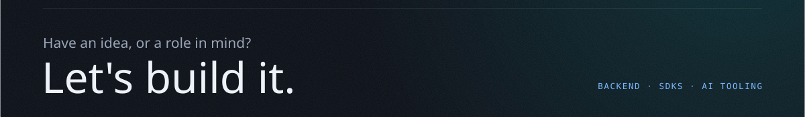</picture><picture><source media="(max-width: 680px)" srcset="./dist/panel/contact-edge-l-mobile.bf11b3fdae.svg"></picture><a href="mailto:prathamshenoy7@gmail.com"><picture><source media="(max-width: 680px)" srcset="./dist/panel/contact-email-me-mobile.43d5f097d7.svg"></picture></a><a href="https://www.linkedin.com/in/pratham-shenoy-6a4b64257/"><picture><source media="(max-width: 680px)" srcset="./dist/panel/contact-linkedin-mobile.1f50bb48aa.svg">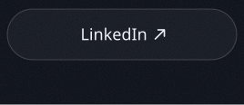</picture></a><a href="https://leetcode.com/u/prathamshenoy7/"><picture><source media="(max-width: 680px)" srcset="./dist/panel/contact-leetcode-mobile.42e3bf4b2e.svg">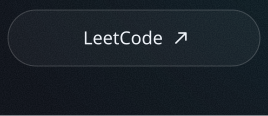</picture></a><a href="https://codeforces.com/profile/prathamshenoy7"><picture><source media="(max-width: 680px)" srcset="./dist/panel/contact-codeforces-mobile.af210b0e3b.svg">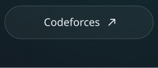</picture></a><picture><source media="(max-width: 680px)" srcset="./dist/panel/contact-edge-r-mobile.5e4a709589.svg"></picture>

Profile in plain text

**Pratham Shenoy** · Software Engineer · India 
Computer Engineering graduate and former SDK Engineer Intern at BrowserStack. I build backends, SDKs and AI tools.

**Toolkit:** Java · Python · TypeScript · React · Node.js · Spring Boot · PostgreSQL · Docker.

**Merged open-source contributions** (40 PRs across 13 projects):

- [Zanadir](https://github.com/MustacheCase/zanadir) - [#684](https://github.com/MustacheCase/zanadir/pull/684) fix(remote): detect settings-enabled Dependabot security updates; [#689](https://github.com/MustacheCase/zanadir/pull/689) Recognise legacy Super-linter and MegaLinter names; [#671](https://github.com/MustacheCase/zanadir/pull/671) feat(rules): recognise lockfile-lint as supply chain; [#640](https://github.com/MustacheCase/zanadir/pull/640) feat(rules): recognize markdown-link-check as a linter; [#574](https://github.com/MustacheCase/zanadir/pull/574) fix(grading): report unchecked SCA ecosystems; [#523](https://github.com/MustacheCase/zanadir/pull/523) Fix recognition and grading of quoted executable paths; [#503](https://github.com/MustacheCase/zanadir/pull/503) Recognise GuardDog as SCA; [#494](https://github.com/MustacheCase/zanadir/pull/494) feat(rules): recognise yamllint as a linter; [#482](https://github.com/MustacheCase/zanadir/pull/482) feat(grading): grade flawfinder action arguments; [#421](https://github.com/MustacheCase/zanadir/pull/421) fix: recognise markdownlint as a linter
- [Apogee](https://github.com/darshi1337/apogee) - [#664](https://github.com/darshi1337/apogee/pull/664) feat: enable remote background summaries, multi-tab synthesis and follow-up questions (B2); [#617](https://github.com/darshi1337/apogee/pull/617) feat: enable opt-in remote Summary and Ask (B1); [#606](https://github.com/darshi1337/apogee/pull/606) feat: add shared remote client and opt-in setup (stage A); [#595](https://github.com/darshi1337/apogee/pull/595) fix: Preserve shared offscreen runs until the last viewer closes; [#571](https://github.com/darshi1337/apogee/pull/571) perf: build history embeddings on demand; [#480](https://github.com/darshi1337/apogee/pull/480) fix: Reject unsupported file uploads (#472)
- [Praxi Bot](https://github.com/emreocell/Praxi-Bot) - [#866](https://github.com/emreocell/Praxi-Bot/pull/866) feat(ui): standing grants view in the Vault screen; [#738](https://github.com/emreocell/Praxi-Bot/pull/738) feat(desktop): praxi:// deep links to open a bot, chat or run; [#485](https://github.com/emreocell/Praxi-Bot/pull/485) feat(release): check versions and generate grouped release notes; [#423](https://github.com/emreocell/Praxi-Bot/pull/423) fix(docs): validate Markdown heading anchors; [#327](https://github.com/emreocell/Praxi-Bot/pull/327) feat(scripts): check contributor prerequisites; [#265](https://github.com/emreocell/Praxi-Bot/pull/265) feat(cli): add shell completions and man pages
- [DeepLocal Chat](https://github.com/petertzy/deeplocal-chat-adapter) - [#89](https://github.com/petertzy/deeplocal-chat-adapter/pull/89) Add bounded read-only parallel subagents; [#87](https://github.com/petertzy/deeplocal-chat-adapter/pull/87) Add bounded verification-driven repair cycles for coding tasks; [#84](https://github.com/petertzy/deeplocal-chat-adapter/pull/84) Prevent TypeScript edit regressions with import and diagnostic checks; [#76](https://github.com/petertzy/deeplocal-chat-adapter/pull/76) Add read-only Git code review mode; [#63](https://github.com/petertzy/deeplocal-chat-adapter/pull/63) test: add focused tool argument validation coverage; [#59](https://github.com/petertzy/deeplocal-chat-adapter/pull/59) Add copy action for completed assistant messages
- [aiset](https://github.com/JamshidS/aiset) - [#138](https://github.com/JamshidS/aiset/pull/138) feat(run): summarize task costs; [#136](https://github.com/JamshidS/aiset/pull/136) fix(run): reveal hidden characters in issue text; [#133](https://github.com/JamshidS/aiset/pull/133) fix: parse supported GitHub issue references
- [PipesHub AI](https://github.com/pipeshub-ai/pipeshub-ai) - [#5750](https://github.com/pipeshub-ai/pipeshub-ai/pull/5750) feat(mcp): add official monday.com server to the catalog; [#5434](https://github.com/pipeshub-ai/pipeshub-ai/pull/5434) feat(mcp): add Airtable to server catalog
- [friday-code](https://github.com/splashxmoon/friday-code) - [#10](https://github.com/splashxmoon/friday-code/pull/10) Add Qwen Code support over ACP
- [GetBlocked](https://github.com/alex-w-developer/GetBlocked) - [#55](https://github.com/alex-w-developer/GetBlocked/pull/55) docs: add Decoy Mode request transformation examples
- [nexy](https://github.com/NexyPy/nexy) - [#672](https://github.com/NexyPy/nexy/pull/672) feat(router): add useRateLimit, a 429 for a client that calls too often
- [SeatSniper](https://github.com/Ishannaik/seatsniper) - [#155](https://github.com/Ishannaik/seatsniper/pull/155) docs: clarify Bun trust handling for Docker
- [smart-retry](https://github.com/AubaidFarrukh/smart-retry) - [#70](https://github.com/AubaidFarrukh/smart-retry/pull/70) feat: respect Retry-After header for fetch retries
- [Keyboard Cheat Codes](https://github.com/techkayacodes/keyboard-cheat-codes) - [#34](https://github.com/techkayacodes/keyboard-cheat-codes/pull/34) feat(colorway): add Cyberpunk 2077 theme
- [patchlint](https://github.com/RubahAnomali/patchlint) - [#59](https://github.com/RubahAnomali/patchlint/pull/59) feat: add a GitHub Action so patchlint runs with uses:

**Featured projects:** [VaultDrive](https://github.com/PrathamShenoy14/VaultDrive) (Cloud storage and file sharing, inspired by Google Drive.) · [HealthBridge AI](https://github.com/PrathamShenoy14/Healthbridge-AI) (Dermatology assistant with image analysis, RAG and AI chat.) · [CareerLink](https://github.com/PrathamShenoy14/CareerLink) (Career guidance, resume building and mock interviews.)

**Contact:** [Email me](mailto:prathamshenoy7@gmail.com) · [LinkedIn](https://www.linkedin.com/in/pratham-shenoy-6a4b64257/) · [LeetCode](https://leetcode.com/u/prathamshenoy7/) · [Codeforces](https://codeforces.com/profile/prathamshenoy7) · [CodeChef](https://www.codechef.com/users/prathamshenoy)

**GitHub activity:** 257 contributions in the last year. Last refreshed 26 NOV 2026.

